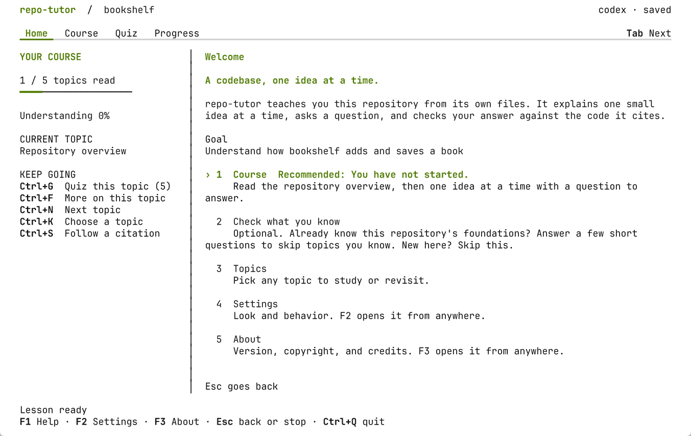
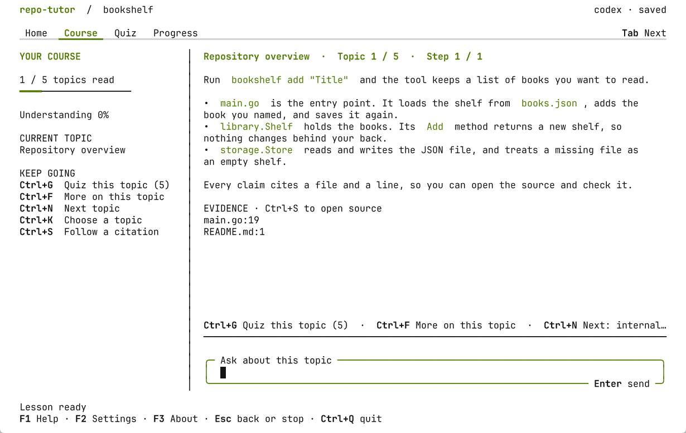
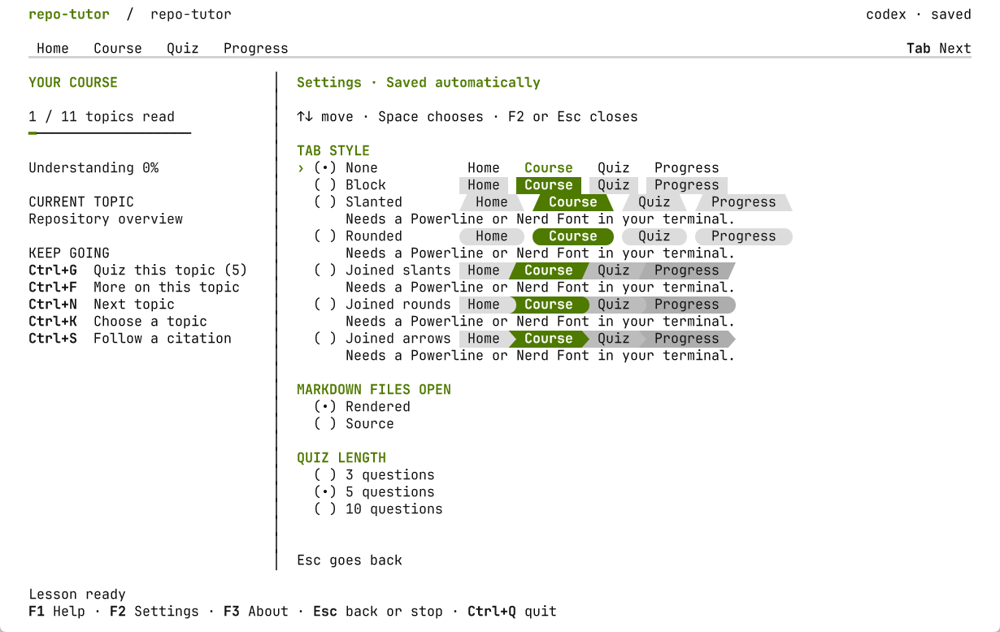
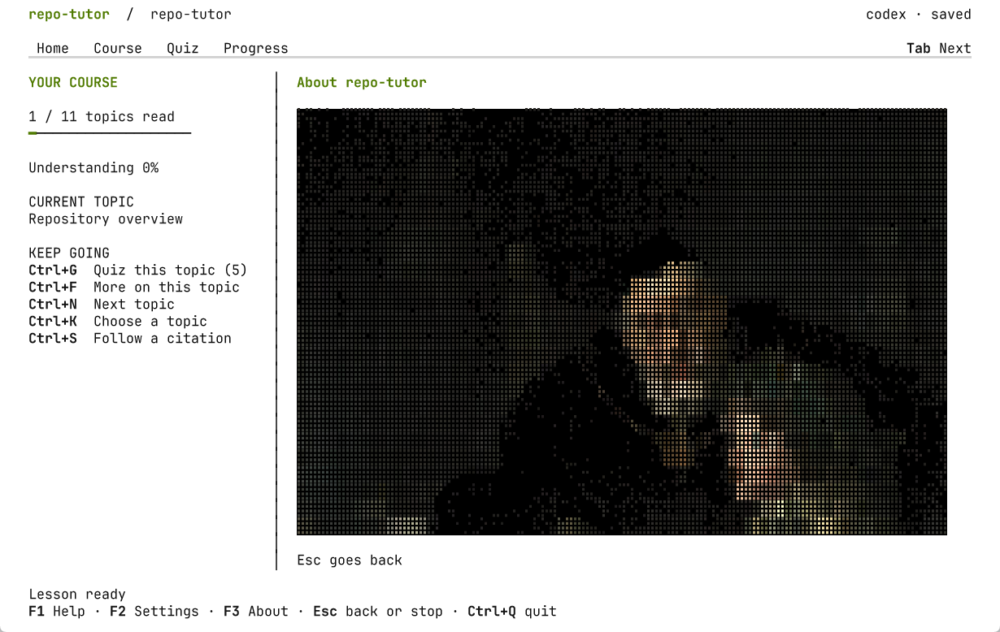

# repo-tutor

Reads a code repository and turns it into a fast onboarding course for a new developer. It helps a new developer become productive in a codebase in the shortest possible time.

## Screenshots

<kbd><a href="images/home-light.png"><picture><source media="(prefers-color-scheme: dark)" srcset="images/home-dark.png"></picture></a></kbd> <kbd><a href="images/course-light.png"><picture><source media="(prefers-color-scheme: dark)" srcset="images/course-dark.png"></picture></a></kbd> <kbd><a href="images/settings-light.png"><picture><source media="(prefers-color-scheme: dark)" srcset="images/settings-dark.png"></picture></a></kbd> <kbd><a href="images/about-light.png"><picture><source media="(prefers-color-scheme: dark)" srcset="images/about-dark.png"></picture></a></kbd>

## Requirements

- macOS or Linux. Windows is not supported natively; use WSL.
- Codex CLI or Claude Code, installed and signed in.
- Nix, only to build from source with `nix develop`.

## Install

Download the archive for your system from the [Releases](https://github.com/8thlight/repo-tutor/releases) page. The names read `repo-tutor_<version>_<os>_<arch>.tar.gz`, for macOS or Linux on `arm64` or `amd64`. Check it, unpack it, and put the binary on your path:

```sh
gh release download v0.1.0 --repo 8thlight/repo-tutor --pattern '*darwin_arm64*' --pattern checksums.txt
grep ' repo-tutor_v0.1.0_darwin_arm64.tar.gz$' checksums.txt | shasum -a 256 -c
gh attestation verify repo-tutor_v0.1.0_darwin_arm64.tar.gz --repo 8thlight/repo-tutor
tar -xzf repo-tutor_v0.1.0_darwin_arm64.tar.gz
install -m 0755 repo-tutor_v0.1.0_darwin_arm64/repo-tutor ~/.local/bin/repo-tutor
```

The attestation shows that the archive was built from this repository by its release workflow. On Linux, use `sha256sum -c` in place of `shasum -a 256 -c` if you prefer.

The macOS binaries are not signed with an Apple Developer ID. A file you download in a browser is quarantined, and macOS refuses to open it; run `xattr -d com.apple.quarantine repo-tutor` once to clear that. Files fetched with `gh` or `curl` are not quarantined.

On Windows, install inside WSL and use the Linux archive: `linux_amd64` on most PCs, `linux_arm64` on Windows on Arm. Install Codex CLI or Claude Code inside WSL too, and keep your repositories and the saved sessions in the Linux file system, not under `/mnt/c`.

With Nix, run it without installing, or add it to your profile:

```sh
nix run github:8thlight/repo-tutor -- ../your-repo
nix profile install github:8thlight/repo-tutor
```

## Build from source

Run:

```sh
nix develop
just build
./output/repo-tutor ../repowise --agent codex
```

To put `repo-tutor` on your path, run `just install`. It copies the binary to `~/.local/bin`; set `PREFIX` to use another prefix.

Use `--agent claude` for Claude Code. Without `--agent`, the tutor chooses Codex when it is installed, then Claude. `just run ../repowise` also starts a session. Omit the path to study the current directory.

## The workspace

In a terminal, the tutor opens a full-screen workspace with a lesson, a box for your questions and answers, and your course progress. The tabs are Home, Course, Quiz, and Progress. Course shows the lesson beside a sidebar with your course status and the keys that apply. Home lists what to do next, with a recommendation first: Course, Check what you know, Topics, Take an exam, Review a weak topic, Progress, Settings, and About.

### Settings

`F2` opens Settings, where you change the tab style, the highlight color (None or one of your terminal's red, green, yellow, blue, magenta, and cyan), whether Markdown opens rendered, the quiz length, and the exam length. They are saved in `settings.json` beside your session folders, and deleting that file resets them.

## Keys

Ask a question, answer one, or browse with the keyboard:

| Shortcut | What it does |
| -- | -- |
| `Enter` | Send your question or answer |
| `Ctrl+N` / `Ctrl+G` | Next (the next question in a quiz, otherwise the next topic; on an open question, press it twice to skip) / quiz this topic |
| `Ctrl+F` | More: more on this topic, or more questions when a quiz is done |
| `Ctrl+B` | Quiz question index and goal |
| `Ctrl+K` | Search topics |
| `Ctrl+S` | Browse citations and every file, and open source at the cited line |
| `Ctrl+P` | Progress: your goal, coverage, understanding by topic, and your latest exam |
| `T` (in a source file) | Teach this file: start a lesson on it |
| `Tab` / `Shift+Tab` | Switch views |
| `PgUp` / `PgDown` | Scroll the lesson or source |
| `Alt+Left` / `Alt+Right` | Read earlier or later saved steps |
| `Esc` / `Ctrl+L` | Go back, or stop what is loading / return to the lesson (press twice to leave a quiz) |
| `Ctrl+R` | Retry a failed request with your draft kept |
| `F1` / `F2` / `F3` | Help / Settings / About |
| `Ctrl+Q` | Save and quit |

Topic and source lists support arrow keys and `/` to filter. Press `Enter` to confirm a filter, then `Enter` again to open an item. You can browse while the tutor thinks. A failed request keeps your draft and completed progress.

## Lessons, quizzes, and exams

A lesson is reading and ends with no question, so the box under it is always for your own questions. An action line offers a quiz on the topic, more on the topic, or the next topic.

In a quiz, the tutor stops at feedback after an answer. Press `Enter` with an empty answer box or `Ctrl+N` when you are ready for the next question, and press `Ctrl+N` twice to skip an open one. You can ask about the feedback before moving on. Each quiz has a goal of 3, 5, or 10 questions, set on the `F2` page. `Ctrl+B` shows answered, current, and upcoming questions, and `A` on a skipped one shows its answer. Incorrect answers and skips still count toward completion, while correctness is tracked separately. After finishing, `Ctrl+F` adds more questions, as many as the quiz length. The next question is prepared while you read and answer the current one.

After you have read ten topics, Home offers an exam with one question from each topic read, up to 10, 20, 30, or every topic read, also set on the `F2` page. An exam you leave after ten questions keeps a partial result.

While a request loads, the lesson pane shows a loading view. Topics stay open, and so do the lesson's sources unless you are moving to another topic. Sources use syntax highlighting with a marker at the cited line. Highlighting needs no language server or extra installation.

## Plain mode

Use `--plain` for line input, terminal scrollback, or a screen reader. Pipes, redirected output, `TERM=dumb`, and `--ask TEXT` use plain output automatically. The full-screen interface adapts to terminal width and draws in your terminal's own colors, so it follows your theme; `NO_COLOR=1` disables color.

The full-screen interface has no slash commands: a line that starts with a slash is sent as a question, and every action has a key, a list, or a Home entry. Slash commands work in plain mode:

| Command | What it does |
| -- | -- |
| `/topics` or `/topics pipeline` | List topics, optionally matching a path |
| `/topic 3` or `/topic internal/tutor` | Study a topic |
| `/next` | Move to the next topic |
| `/probe` | Answer three short questions; topics you know are marked known and skipped by `/next` |
| `/quiz` | Start a quiz on this topic (3, 5, or 10 questions, set with `F2`) |
| `/continue` | Move on after reviewing an answer |
| `/questions` or `/extend` | Show the quiz index or add more questions after finishing |
| `/progress` or `/review` | See recorded outcomes or revisit a weak topic |
| `/hotspots` | List files with churn and branching logic (the full-screen interface teaches them as the "Where change happens" topic) |
| `/sources` or `/read README.md:1` | Inspect the source snapshot |
| `/map` or `/glossary` | Show a dependency diagram or type index |
| `/quit` | Save and exit |

## Your goal

The first time you open a repository, the tutor asks what you want to learn. Press `Enter` to keep the suggested goal or type your own. `--goal` answers it ahead of time. Your progress saves automatically. Run the same command to resume. Use `--new` to archive the previous session and start again, or `--goal "Trace the persistence pipeline"` when starting a course. `--model NAME` selects a model through the chosen CLI.

## Scan without an agent

```sh
./output/repo-tutor scan ../repowise
./output/repo-tutor scan ../repowise --json > output/scan.json
./output/repo-tutor scan ../repowise --map > output/dependencies.mmd
./output/repo-tutor doctor
```

Scanning and source browsing run locally. Tutor turns send selected source excerpts to your installed agent CLI. The tutor does not call a model API or edit the repository being studied.

Go analysis uses the standard Go parser. Python and JavaScript/TypeScript analysis recognizes literal imports and declaration patterns. It can miss dynamic imports, aliases, and re-exports. Dependency order is a reading aid; the scan does not build or type-check the target.

Hotspots combine recent local Git changes and branch counts. The counts help choose what to read and test. They do not predict defects. Git is optional, and shallow history can undercount churn.

## Saved sessions

Sessions live under `repo-tutor` in `XDG_STATE_HOME`, when set, or your operating system's user configuration directory. The startup output shows the exact file. Use `--state-dir DIRECTORY` to choose another location.

Each repository has its own session, with the last 200 turns and per-topic outcomes. A changed source snapshot starts a fresh course, keeps your topic progress, and saves the old session as `previous.json`. Starting with `--new` also replaces that one archive. Agent, model, and goal changes require a new session. The turn timeout defaults to three minutes; change it with `--timeout 5m`. While you read, the workspace prepares the next topic's first lesson in the background and caches it beside the session, and during a quiz it prepares the next question; `--no-prefetch` turns both off. Lesson files for goals other than the current one are deleted when they are sixty days old.

If a request fails, its reply and assessment are not recorded. Check the reported login, quota, or format error, then retry. Choose another agent with `--agent codex --new` or `--agent claude --new`.

## Flow

1. Scan the repository into a structured model: modules, entry points, dependencies, key terms.
2. Check what study material exists: README, ADRs, diagrams, glossary.
3. Generate what is missing: architecture diagrams, dependency graphs, glossary, summaries.
4. Order topics from the dependency graph, foundations first.
5. Run tutor and quiz sessions grounded in real files and line citations.
6. Track learner progress and focus on weak areas.

## Status

Initial terminal tutor for Go, Python, and JavaScript/TypeScript repositories, on macOS and Linux. Diagrams and the type index are available in the terminal. Further work includes generated study guides and richer progress scheduling. See [architecture](docs/architecture/README.md), [decisions](docs/decisions), and [stack](docs/stack/README.md).

## Development

```sh
nix develop
just check
just build
```

Checks cover formatting, documentation, source analysis, agent event protocols, session persistence, and terminal acceptance scenarios. Automated tests use fake agent processes and require no account or network connection.

## License

Copyright © 2026 8th Light, LLC. Licensed under the GNU General Public License, version 3 or later. See [LICENSE](LICENSE).

8th Light® and the 8th Light logo are trademarks of 8th Light, LLC and are not covered by the GNU General Public License.

<a href="https://8thlight.com"></a>
