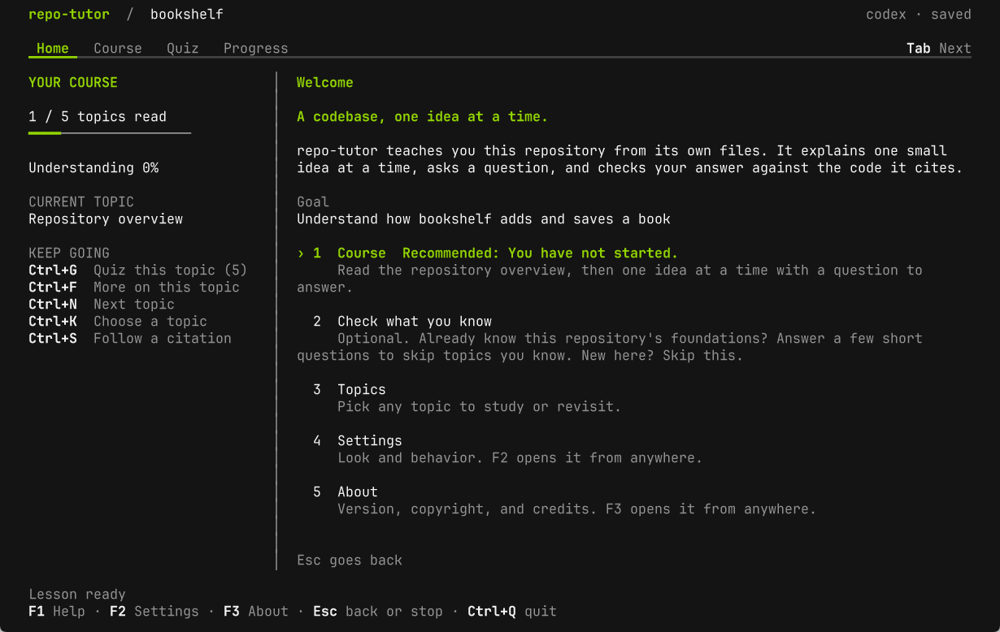
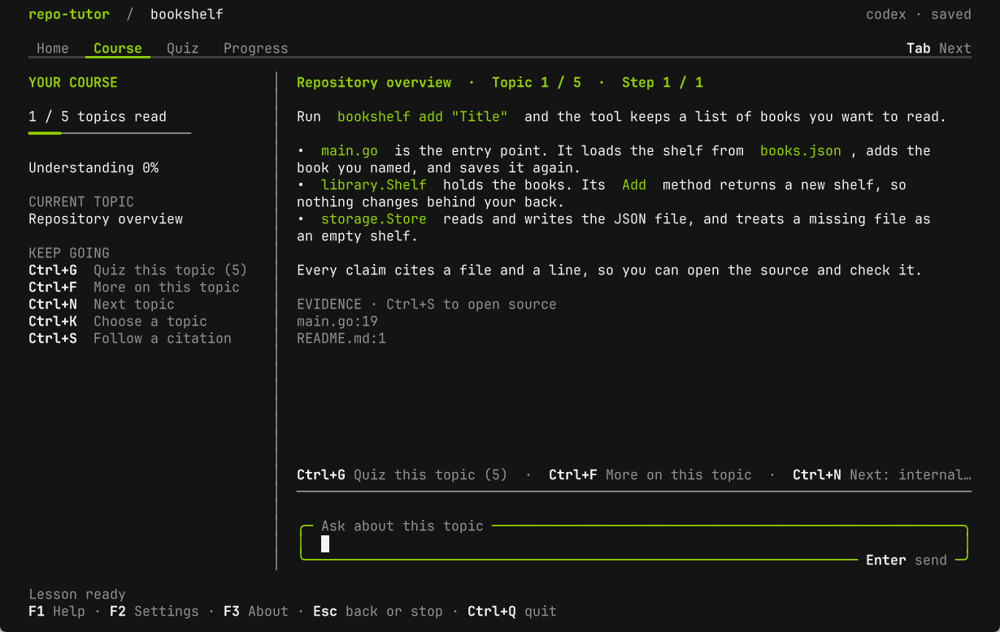
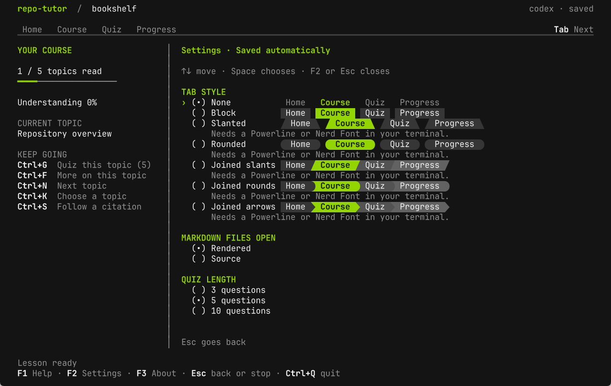
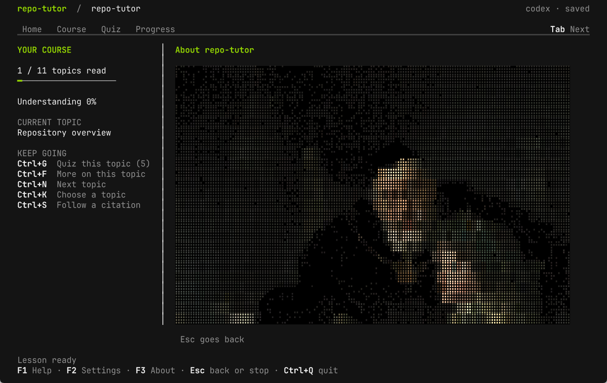

# Gallery

The interface in a light terminal on the left and a dark terminal on the right. `just screenshots` generates these images from the real binary.

## Home

<kbd></kbd> <kbd></kbd>

## Course

<kbd></kbd> <kbd></kbd>

## Settings

<kbd></kbd> <kbd></kbd>

## About

<kbd></kbd> <kbd></kbd>
